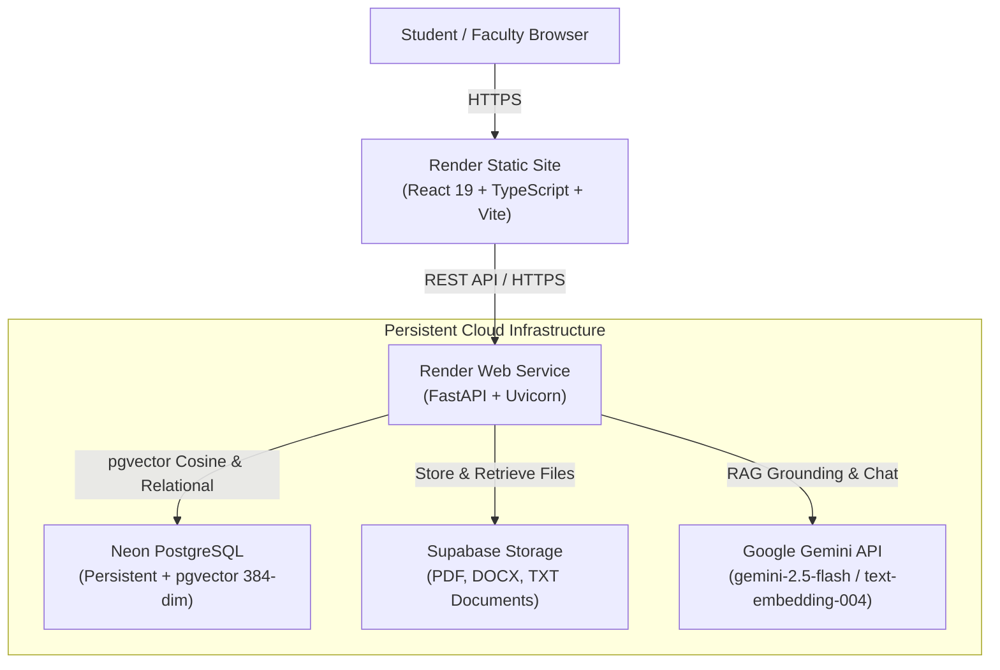
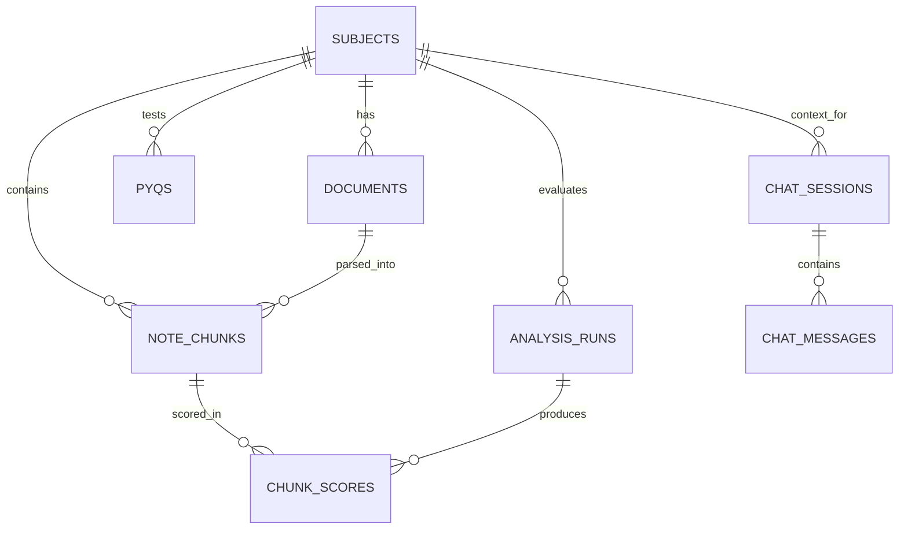

# 📚 Semantic PYQ Analyzer & Study Heatmap

> A vector-database-powered academic study platform that semantically correlates Previous Year Questions (PYQs) to course notes, computes paragraph-level importance scores, displays a colour-coded study heatmap, and provides an AI study assistant grounded in curriculum materials.


---

## ☁️ Public Cloud Deployment (Zero-Cost Free Tier)

This application is ready to run 24/7 on free-tier cloud services without requiring your laptop powered on or local Ollama running.

👉 **[Read the Complete Deployment Guide (DEPLOYMENT_GUIDE.md)](DEPLOYMENT_GUIDE.md)** for detailed instructions.

### Cloud Architecture Stack:
- **Frontend (Render Static Site):** React 19 + TypeScript + Vite with client-side SPA routing (`/*` -> `/index.html`).
- **Backend (Render Web Service):** FastAPI running on Uvicorn, bound to dynamic port `$PORT` with auto-TLS and `/health` check.
- **Database (Neon PostgreSQL):** Persistent cloud PostgreSQL with native `pgvector` and HNSW cosine distance indexes.
- **Document Storage (Supabase Storage):** Persistent cloud object storage for uploaded PDFs, DOCX, and TXT files.
- **AI Study Assistant (Google Gemini API):** `gemini-2.5-flash` with strict RAG context grounding and `text-embedding-004` (384-dimensional dense vectors).

---

## 🌟 Highlights & Key Features

- **🔥 Paragraph-Level Study Heatmap**: Color-codes lecture notes by exam recurrence using pgvector cosine similarity (`<=>`), classifying sections into High-Yield (≥70%), Medium-Yield (40–69%), and Low-Yield (10–39%).
- **🤖 Cloud AI Study Assistant (RAG)**: Interactive chat interface powered by Google Gemini API, grounded strictly in retrieved course notes and related exam questions with verifiable citations.
- **⚡ pgvector + HNSW Indexing**: High-speed Approximate Nearest Neighbor (ANN) vector searches with logarithmic $O(\log N)$ retrieval complexity directly in PostgreSQL.
- **📄 Persistent Document Storage**: Ingests, validates, chunks (300 words, 50 overlap), and stores `.pdf`, `.docx`, and `.txt` notes in Supabase Storage with download and inline view support.
- **📊 Question Library & Batch CSV**: Full CRUD for PYQs with multi-parameter filtering (year, marks, unit) and batch CSV importing.
- **🔍 Instant Semantic Search**: Real-time natural language query search ranking notes by semantic cosine similarity.
- **📈 Visual Curriculum Analytics**: Interactive Recharts data visualizations for exam year distributions, marks allocation weightages, and top high-yield paragraphs.
- **⚙️ Live Cloud Health Monitoring**: Real-time connection checks for Neon DB, pgvector, Gemini AI, and Supabase Storage without exposing secret credentials.

---

## 🏗️ System Architecture



---

## 📐 Database Schema & Relationships

The relational model satisfies **Boyce-Codd Normal Form (BCNF)** across all entities:



---

## 🚀 Deployment Steps (Render Blueprint)

1. **Fork or Push** this repository to your GitHub account:
   ```bash
   https://github.com/keshavjayaprakash2006-hash/DBMS-.git
   ```
2. **Create free services:**
   - **Neon Database**: Create a project at [console.neon.tech](https://console.neon.tech) and run `CREATE EXTENSION IF NOT EXISTS vector;`.
   - **Gemini API Key**: Obtain a free key at [aistudio.google.com/app/apikey](https://aistudio.google.com/app/apikey).
   - **Supabase Storage**: Create a free project at [supabase.com](https://supabase.com) and create a bucket named `documents`.
3. **Deploy on Render:**
   - Go to [dashboard.render.com](https://dashboard.render.com) -> **New +** -> **Blueprint**.
   - Select your repository.
   - Enter your `DATABASE_URL`, `GEMINI_API_KEY`, `SUPABASE_URL`, and `SUPABASE_SERVICE_ROLE_KEY`.
   - Render automatically deploys the backend and frontend.
4. **Set Frontend API URL:**
   - Set `VITE_API_URL` on the frontend Static Site to your backend's public URL (e.g., `https://semantic-pyq-backend.onrender.com`).
   - Trigger a manual rebuild of the Static Site.

---

## 💻 Local Development Setup

### Option A: Local Native Execution
```bash
# Backend setup
cd backend
python -m pip install -r requirements.txt
uvicorn app.main:app --reload --port 8000

# Frontend setup (in a separate terminal)
cd frontend
npm install
npm run dev
```

### Option B: Docker Compose
```bash
docker compose up -d --build
```
- Open [http://localhost:5173](http://localhost:5173) (or `http://localhost:3000`) for the web app.
- Open [http://localhost:8000/docs](http://localhost:8000/docs) for the interactive Swagger API docs.

---

## 🧪 Automated Testing

The backend includes a comprehensive pytest suite covering all modules:

```bash
cd backend
python -m pytest tests/ -v
```
**Test coverage:**
- `test_subjects.py`: Subject creation, retrieval, updates, cascade deletion.
- `test_pyqs.py`: PYQ CRUD, marks/year validation, CSV bulk import, error handling.
- `test_document_service.py`: Text extraction (PDF, DOCX, TXT), paragraph chunking, sliding window overlap.
- `test_search.py`: Semantic search query validation, cosine similarity distance.
- `test_analysis.py`: Heatmap analysis pipeline, prerequisite checks, score thresholds.
- `test_chat.py`: Multi-session chat management, RAG context assembly, graceful fallback.
- `test_cloud_services.py`: Gemini prompt structuring, Supabase storage fallback, document download, live health checks.

---


## 📁 Repository Structure

```
DBMS-/
├── backend/
│   ├── app/
│   │   ├── api/            # REST API routers (subjects, documents, pyqs, analysis, search, chat, health)
│   │   ├── core/           # Configuration, logging, environment variables
│   │   ├── db/             # SQLAlchemy engine, session maker, pgvector initialization
│   │   ├── models/         # SQLAlchemy ORM models with 384-dim Vector columns
│   │   ├── schemas/        # Pydantic validation schemas
│   │   ├── services/       # Gemini chat, embeddings, document extractor, storage
│   │   └── main.py         # FastAPI application entrypoint with CORS & health check
│   ├── tests/              # 43 automated passing pytest tests
│   ├── Dockerfile
│   └── requirements.txt
├── frontend/
│   ├── public/             # Static assets and SPA _redirects rule
│   ├── src/
│   │   ├── layouts/        # Layout and navigation sidebar
│   │   ├── pages/          # All 9 views (Dashboard, Heatmap, Search, Chat, Notes, etc.)
│   │   ├── services/       # Axios API client with dynamic production URL
│   │   ├── types/          # TypeScript interface definitions
│   │   ├── App.tsx         # Route registry
│   │   └── main.tsx        # React 19 entrypoint
│   ├── package.json
│   └── vite.config.ts
├── data/sample/            # Curated study notes and PYQ CSV files (OS & DBMS)
├── docs/                   # Complete architecture, database, API, setup, and viva docs
├── scripts/                # Automated seed data and setup shell scripts
├── DEPLOYMENT_GUIDE.md     # Step-by-step cloud deployment guide
├── render.yaml             # Render infrastructure-as-code blueprint
├── docker-compose.yml      # Local multi-container orchestration
└── .env.example            # Environment configuration template
```

---

## 📄 License
This project is licensed under the MIT License - see the LICENSE file for details.
