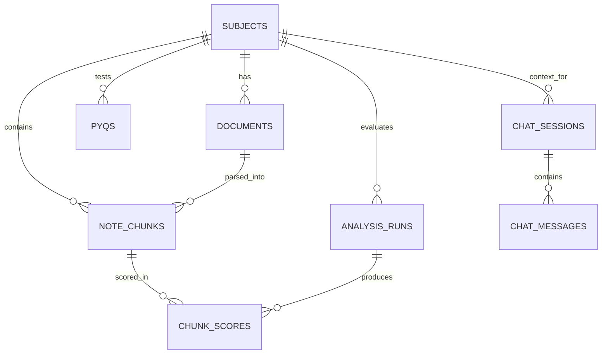

# 📚 Semantic PYQ Analyzer & Study Heatmap

> An offline-first, vector-database-powered study platform that semantically correlates Previous Year Questions (PYQs) to course notes, computes paragraph-level importance scores, displays a colour-coded study heatmap, and provides an AI study assistant.


---

## 🌟 Highlights & Key Features

- **🔥 Paragraph-Level Study Heatmap**: Color-codes lecture notes by exam recurrence using pgvector cosine similarity (`<=>`), classifying sections into High-Yield (≥70%), Medium-Yield (40–69%), and Low-Yield (10–39%).
- **🧠 100% Offline AI & Embeddings**: Uses local `sentence-transformers/all-MiniLM-L6-v2` (384-dimensional dense vectors) and local Ollama (`mistral` / `llama3`). Zero paid API keys, zero external internet dependencies during operation.
- **⚡ pgvector + HNSW Indexing**: High-speed Approximate Nearest Neighbor (ANN) searches with logarithmic $O(\log N)$ retrieval complexity directly in PostgreSQL.
- **📄 Document Ingestion Pipeline**: Extracts and chunks `.pdf`, `.docx`, and `.txt` files with paragraph-aware sliding windows (300 words, 50-word overlap) and background vectorization.
- **📊 Question Library & Batch CSV**: Full CRUD for PYQs with multi-parameter filtering (year, marks, unit) and batch CSV importing.
- **🔍 Instant Semantic Search**: Real-time natural language search ranking notes by semantic cosine distance rather than mere keyword matching.
- **🤖 Grounded RAG Assistant**: Interactive chat interface with multi-session history and verifiable citations to specific paragraphs and exam questions.
- **📈 Visual Curriculum Analytics**: Recharts data visualizations for exam year distributions, marks allocation weightages, and top high-yield paragraphs.

---

## 🏗️ System Architecture

```
┌────────────────────────────────────────────────────────────────────────┐
│                          PRESENTATION LAYER                            │
│           React 19 + TypeScript + Vite + Tailwind CSS (SPA)            │
│  - Dashboard  - Subjects  - Notes  - PYQs  - Heatmap  - Search  - Chat │
└───────────────────────────────────┬────────────────────────────────────┘
                                    │ HTTP / JSON
┌───────────────────────────────────▼────────────────────────────────────┐
│                           API & SERVICE LAYER                          │
│                      FastAPI (Python 3.10+)                            │
│  - Document Extractor (PDF/DOCX/TXT)   - Chunking Engine (300w / 50ov) │
│  - Vector Embedding Service (all-MiniLM-L6-v2, 384-d dense vectors)    │
│  - Cosine Distance Matcher (<=>)       - Importance Scoring Engine     │
│  - RAG Context Retriever               - Local Ollama LLM Connector    │
└───────────────────────────────────┬────────────────────────────────────┘
                                    │ SQL / pgvector
┌───────────────────────────────────▼────────────────────────────────────┐
│                           PERSISTENCE LAYER                            │
│                   PostgreSQL 16 + pgvector Extension                   │
│  - Relational Schema (Subjects, Documents, Chunks, PYQs, Scores)       │
│  - HNSW Vector Indexes (Cosine Distance `vector_cosine_ops`)           │
│  - B-Tree Relational Indexes (Foreign Keys, Year, Marks)               │
└────────────────────────────────────────────────────────────────────────┘
```

---

## 📐 Database Schema & Relationships

The relational model satisfies **Boyce-Codd Normal Form (BCNF)** across all entities:



Detailed schema definitions, foreign key rules, and index explanations can be found in [docs/DATABASE_DESIGN.md](docs/DATABASE_DESIGN.md).

---

## 🚀 Quickstart Guide

### Option A: One-Command Docker Setup (Recommended)

Run the full stack (PostgreSQL + pgvector, Backend, Frontend) with Docker Compose:

```bash
# 1. Clone repository
git clone https://github.com/keshavjayaprakash2006-hash/DBMS-.git
cd DBMS-

# 2. Launch services
docker compose up -d --build

# 3. Seed sample data (OS and DBMS course notes + PYQs)
python scripts/seed_sample_data.py
```

- **Web Application**: Open [http://localhost:3000](http://localhost:3000)
- **API Documentation**: Open [http://localhost:8000/docs](http://localhost:8000/docs)

---

### Option B: Local Native Setup

#### 1. Database Setup
Install PostgreSQL 15+ and enable the `pgvector` extension:
```sql
CREATE DATABASE pyq_analyzer;
\c pyq_analyzer;
CREATE EXTENSION IF NOT EXISTS vector;
```

#### 2. Backend Setup
```bash
# Copy environment configuration
cp .env.example .env

# Install backend dependencies
cd backend
pip install -r requirements.txt

# Run migrations and start server
alembic upgrade head
uvicorn app.main:app --reload --port 8000
```

#### 3. Frontend Setup
```bash
# In a new terminal
cd frontend
npm install
npm run dev
```
Open [http://localhost:5173](http://localhost:5173).

#### 4. Seed Demonstration Data
```bash
python scripts/seed_sample_data.py
```

---

## 🧪 Testing & Verification

The test suite covers chunking algorithms, vector embedding dimensions, PYQ CSV imports, cascade deletes, and offline fallbacks:

```bash
# Run backend test suite (39 automated tests)
cd backend
python -m pytest tests/ -v

# Run frontend production build & type checks
cd frontend
npm run build
```

See [docs/TESTING.md](docs/TESTING.md) for detailed test documentation.

---

## 🎓 Faculty Demonstration Script

For academic evaluation and viva demonstration, execute the queries in [docs/SQL_DEMONSTRATIONS.sql](docs/SQL_DEMONSTRATIONS.sql):

```bash
psql -U postgres -d pyq_analyzer -f docs/SQL_DEMONSTRATIONS.sql
```

The script demonstrates:
1. `pgvector` extension and HNSW index verification.
2. Cosine distance queries (`<=>`) calculating semantic similarity.
3. Multi-table joins connecting PYQs to note paragraphs.
4. Window functions (`DENSE_RANK()`) ranking high-yield curriculum paragraphs.
5. Transactional rollback and referential integrity (`ON DELETE CASCADE`).

---

## 📁 Repository Structure

```
DBMS-/
├── backend/
│   ├── app/
│   │   ├── api/            # REST API routers (subjects, documents, pyqs, heatmap, search, chat)
│   │   ├── core/           # Configuration and logging
│   │   ├── db/             # SQLAlchemy engine, session maker, pgvector init
│   │   ├── models/         # SQLAlchemy ORM models with Vector columns
│   │   ├── schemas/        # Pydantic validation schemas
│   │   ├── services/       # Document extraction, embeddings, scoring, RAG chat
│   │   └── main.py         # FastAPI application entrypoint
│   ├── migrations/         # Alembic database migrations
│   ├── tests/              # Pytest test suite (39 passing tests)
│   ├── Dockerfile
│   └── requirements.txt
├── frontend/
│   ├── src/
│   │   ├── layouts/        # Layout and navigation sidebar
│   │   ├── pages/          # All 9 functional views (Dashboard, Heatmap, Search, Chat, etc.)
│   │   ├── services/       # Axios API client
│   │   ├── types/          # TypeScript interface definitions
│   │   ├── App.tsx         # Route registry
│   │   └── main.tsx        # React 19 entrypoint
│   ├── Dockerfile
│   └── package.json
├── data/sample/            # Curated study notes and PYQ CSV files (OS & DBMS)
├── docs/                   # Complete architecture, database, API, setup, and testing docs
├── scripts/                # Automated seed data and setup shell scripts
├── docker-compose.yml      # Multi-container orchestration
└── .env.example            # Environment configuration template
```

---

## 📄 License
This project is licensed under the MIT License - see the LICENSE file for details.
