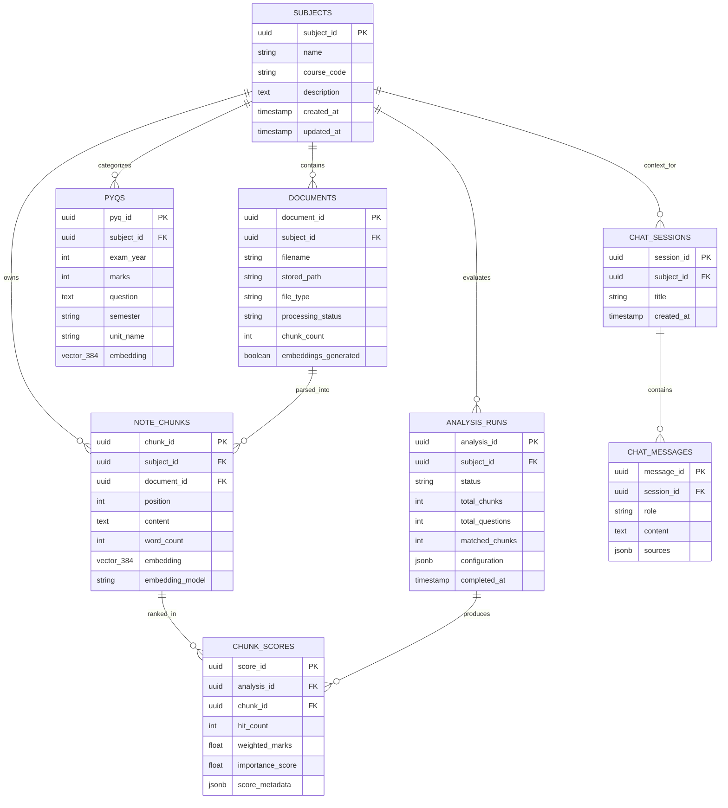

# Database Design & Relational Schema Specification

## 1. Entity-Relationship (ER) Architecture

The database follows Boyce-Codd Normal Form (BCNF) principles for all relational metadata, enhanced with vector column extensions provided by `pgvector`.



---

## 2. Table Specifications

### 2.1 `subjects`
Stores course/module level entities.
| Column | Type | Constraints | Description |
| :--- | :--- | :--- | :--- |
| `subject_id` | `UUID` | `PRIMARY KEY` | Globally unique identifier |
| `name` | `VARCHAR(255)` | `NOT NULL` | Course title (e.g. Operating Systems) |
| `course_code` | `VARCHAR(50)` | `NULLABLE` | Official university code (e.g. CS204) |
| `description` | `TEXT` | `NULLABLE` | Syllabus overview or scope |
| `created_at` | `TIMESTAMPTZ`| `NOT NULL` | UTC creation timestamp |
| `updated_at` | `TIMESTAMPTZ`| `NOT NULL` | UTC update timestamp |

### 2.2 `documents`
Tracks uploaded files (PDF, DOCX, TXT) and processing lifecycles.
| Column | Type | Constraints | Description |
| :--- | :--- | :--- | :--- |
| `document_id` | `UUID` | `PRIMARY KEY` | File identifier |
| `subject_id` | `UUID` | `FK -> subjects(subject_id) ON DELETE CASCADE` | Parent course |
| `filename` | `VARCHAR(500)` | `NOT NULL` | Original uploaded filename |
| `stored_path` | `VARCHAR(1000)`| `NOT NULL` | Safe disk storage path |
| `file_type` | `VARCHAR(50)` | `NOT NULL` | File format (`pdf`, `docx`, `txt`) |
| `processing_status` | `VARCHAR(50)` | `DEFAULT 'pending'` | Processing state (`pending`, `processing`, `completed`, `failed`) |
| `extracted_text_length` | `INTEGER` | `NULLABLE` | Extracted character count |
| `chunk_count` | `INTEGER` | `DEFAULT 0` | Total paragraph chunks created |
| `embeddings_generated` | `BOOLEAN` | `DEFAULT FALSE` | Vectorization completion flag |

### 2.3 `note_chunks`
Contains individual semantic paragraphs and their vector representations.
| Column | Type | Constraints | Description |
| :--- | :--- | :--- | :--- |
| `chunk_id` | `UUID` | `PRIMARY KEY` | Chunk identifier |
| `subject_id` | `UUID` | `FK -> subjects(subject_id) ON DELETE CASCADE` | Course identifier |
| `document_id` | `UUID` | `FK -> documents(document_id) ON DELETE CASCADE` | Source document |
| `position` | `INTEGER` | `NOT NULL` | Paragraph index within document |
| `content` | `TEXT` | `NOT NULL` | Actual paragraph text |
| `word_count` | `INTEGER` | `DEFAULT 0` | Word count |
| `embedding` | `vector(384)`| `NULLABLE` | 384-dimensional dense vector |
| `embedding_model` | `VARCHAR(200)`| `NULLABLE` | Model name (`all-MiniLM-L6-v2`) |

### 2.4 `pyqs`
Previous Year Questions extracted or imported from past exam papers.
| Column | Type | Constraints | Description |
| :--- | :--- | :--- | :--- |
| `pyq_id` | `UUID` | `PRIMARY KEY` | Question identifier |
| `subject_id` | `UUID` | `FK -> subjects(subject_id) ON DELETE CASCADE` | Associated subject |
| `exam_year` | `INTEGER` | `NOT NULL` | Year the exam was conducted |
| `marks` | `INTEGER` | `NOT NULL` | Question marks allocation |
| `question` | `TEXT` | `NOT NULL` | Full question text |
| `semester` | `VARCHAR(50)` | `NULLABLE` | Exam semester |
| `course_code` | `VARCHAR(50)` | `NULLABLE` | Course identifier |
| `unit_name` | `VARCHAR(255)`| `NULLABLE` | Syllabus unit or module tag |
| `embedding` | `vector(384)`| `NULLABLE` | 384-dimensional dense vector |

### 2.5 `analysis_runs`
Tracks batch semantic heatmap calculations per subject.
| Column | Type | Constraints | Description |
| :--- | :--- | :--- | :--- |
| `analysis_id` | `UUID` | `PRIMARY KEY` | Analysis run identifier |
| `subject_id` | `UUID` | `FK -> subjects(subject_id) ON DELETE CASCADE` | Subject analyzed |
| `status` | `VARCHAR(50)` | `DEFAULT 'pending'` | Execution status |
| `total_chunks` | `INTEGER` | `DEFAULT 0` | Chunks analyzed |
| `total_questions`| `INTEGER` | `DEFAULT 0` | PYQs evaluated |
| `matched_chunks`| `INTEGER` | `DEFAULT 0` | Chunks matched to at least 1 PYQ |
| `configuration` | `JSONB` | `NULLABLE` | Run settings (top_k, threshold) |
| `completed_at` | `TIMESTAMPTZ`| `NULLABLE` | Completion timestamp |

### 2.6 `chunk_scores`
Stores calculated importance and PYQ match evidence per chunk.
| Column | Type | Constraints | Description |
| :--- | :--- | :--- | :--- |
| `score_id` | `UUID` | `PRIMARY KEY` | Score identifier |
| `analysis_id` | `UUID` | `FK -> analysis_runs(analysis_id) ON DELETE CASCADE` | Parent analysis run |
| `chunk_id` | `UUID` | `FK -> note_chunks(chunk_id) ON DELETE CASCADE` | Target chunk |
| `hit_count` | `INTEGER` | `DEFAULT 0` | Number of distinct PYQs matched |
| `weighted_marks`| `FLOAT` | `DEFAULT 0.0` | Marks multiplied by similarity |
| `importance_score`| `FLOAT` | `DEFAULT 0.0` | Normalized importance (0.0 to 1.0) |
| `score_metadata`| `JSONB` | `NULLABLE` | Matched question details & ranks |
| *Constraint* | `UNIQUE` | `(analysis_id, chunk_id)` | One score per chunk per analysis run |

---

## 3. Indexing Strategy

### 3.1 HNSW Vector Indexing
High-speed approximate nearest neighbor (ANN) search is powered by **Hierarchical Navigable Small World (HNSW)** indexes:

```sql
CREATE INDEX idx_note_chunks_embedding_hnsw
ON note_chunks USING hnsw (embedding vector_cosine_ops)
WITH (m = 16, ef_construction = 64);

CREATE INDEX idx_pyqs_embedding_hnsw
ON pyqs USING hnsw (embedding vector_cosine_ops)
WITH (m = 16, ef_construction = 64);
```
- **Operator**: `vector_cosine_ops` matches the `<=>` cosine distance operator.
- **Complexity**: Search time is logarithmic $O(\log N)$, allowing sub-millisecond retrieval across tens of thousands of paragraphs.

### 3.2 B-Tree Relational Indexing
- Foreign key columns (`subject_id`, `document_id`, `analysis_id`, `chunk_id`) have standard B-Tree indexes for fast `JOIN` resolution and cascade deletes.
- Multi-column indexes on `(subject_id, exam_year)` and `(subject_id, marks)` accelerate dashboard analytics and library filters.
